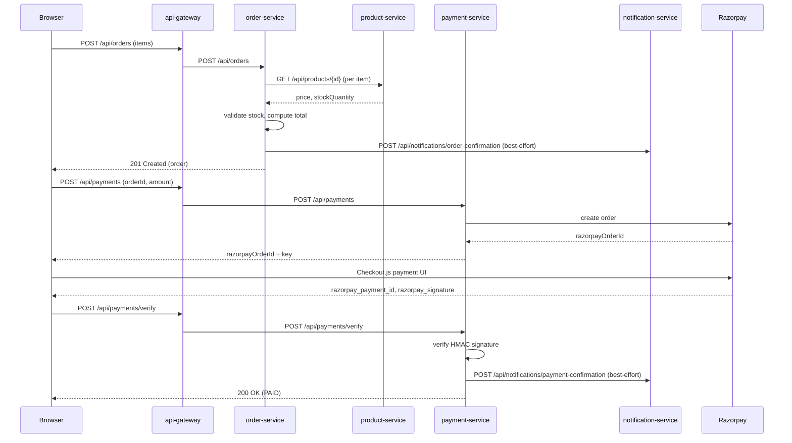

# Architecture

## Services
| Service | Port | Responsibility | DB |
|---|---|---|---|
| api-gateway | 8080 | single entry point, routing, CORS, rate limiting, correlation IDs | - |
| auth-service | 8081 | registration, login, JWT issuance, roles | ecommerce_auth |
| product-service | 8082 | catalog, categories, search | ecommerce_product |
| order-service | 8083 | cart, orders, order lifecycle | ecommerce_order |
| payment-service | 8084 | Razorpay order creation, signature/webhook verification | ecommerce_payment |
| notification-service | 8085 | email on order/payment events (internal-only, not routed via gateway) | ecommerce_notification |
| frontend (Next.js) | 3000 | storefront UI | - |

## Communication
- Frontend -> services: REST over api-gateway (Spring Cloud Gateway Server MVC) at :8080. The browser only ever talks to this one origin; the gateway path-routes to auth/product/order/payment-service. notification-service is deliberately not routed here since it's only ever called service-to-service.
- Service -> service: REST via Spring's `RestClient` (order-service -> product-service for stock/price checks; order-service and payment-service -> notification-service, best-effort/fire-and-forget).
- Notifications are triggered by direct REST calls rather than a message broker (RabbitMQ) — call volume doesn't yet justify that infra; revisit if event fan-out or retry/replay semantics become necessary.
- Cross-cutting: the gateway stamps every request with an `X-Request-Id` correlation header (generated or passed through) and applies a simple per-IP fixed-window rate limit.

## Checkout flow

## Data ownership
Each service owns its own Postgres schema/database. No service reads another's tables directly — only through its API. Each runs its own Flyway/JPA migrations.

## Auth model
- auth-service issues short-lived JWT access tokens + refresh tokens, set as httpOnly, SameSite=Lax cookies (`access_token` / `refresh_token`) - never exposed to JS, closing off the XSS-can-steal-the-token risk that comes with localStorage-based tokens.
- Other services are resource servers: they validate the JWT signature/claims locally (shared secret in dev, would be a shared public key with asymmetric signing in production), no per-request call back to auth-service. Each JwtAuthFilter accepts the token from the cookie (browser traffic) or an `Authorization: Bearer` header (service-to-service calls, tooling).
- Every service exposes interactive API docs at `/swagger-ui.html` (OpenAPI spec at `/v3/api-docs`) via springdoc.

## Phase status
- [x] Phase 0 - Setup & Architecture
- [x] Phase 1 - Core infra skeleton
- [x] Phase 2 - Auth service
- [x] Phase 3 - Product service
- [x] Phase 4 - Order service
- [x] Phase 5 - Payment service
- [x] Phase 6 - Notification service
- [x] Phase 7 - Cross-cutting (gateway, logging, rate limiting)
- [x] Phase 8 - Testing (deep Mockito + Testcontainers coverage on auth-service and order-service; light unit tests on product/payment/notification-service)
- [x] Phase 9 - CI/CD (GitHub Actions matrix build+test across all 6 backend services, plus a frontend lint/typecheck/build job)
- [ ] Phase 10 - Deployment (skipped for now, no AWS account available)
- [x] Phase 11 - Hardening & polish (JWT moved to httpOnly cookies, OpenAPI docs added; load testing and DB tuning deferred until there's a deployed environment/real data volume)
